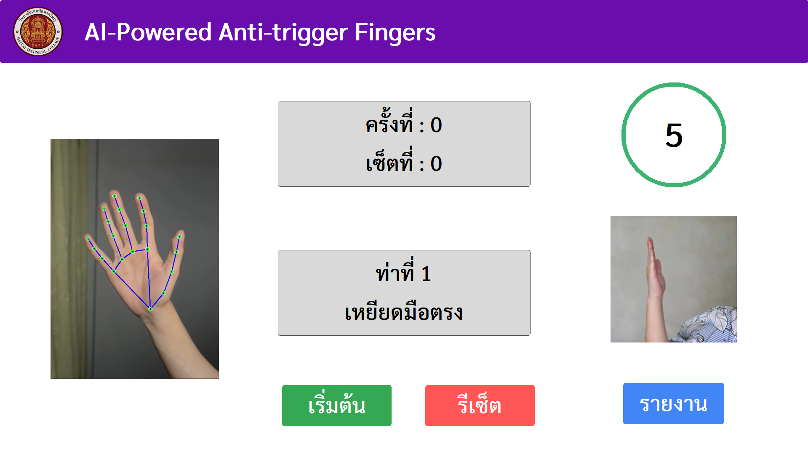
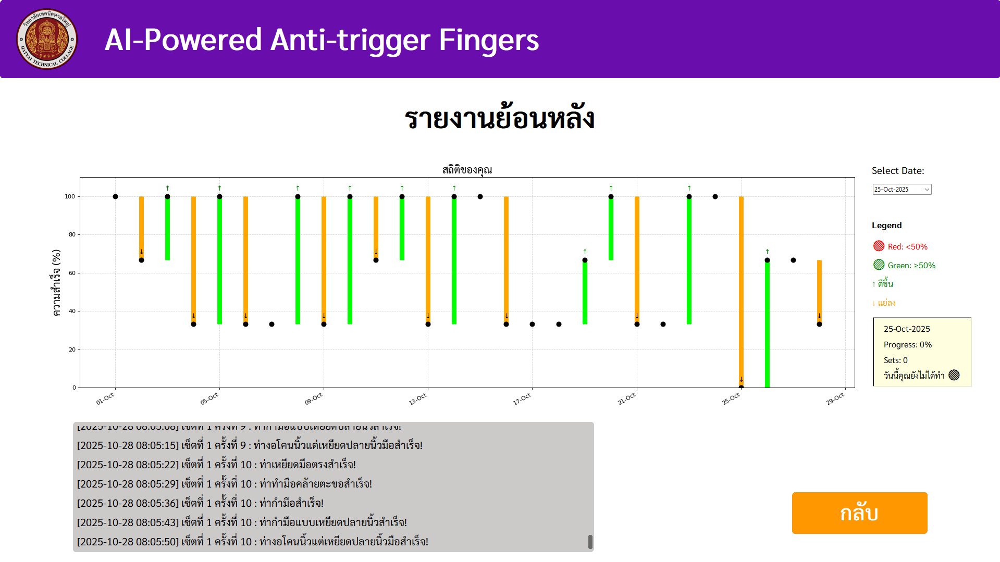

# my-finger-project- PC

โปรแกรมฝึกบริหารมือสำหรับป้องกันและฟื้นฟูอาการนิ้วล็อก (Trigger Finger) บนคอมพิวเตอร์ Windows ใช้เว็บแคมตรวจจับท่ามือแบบเรียลไทม์ด้วย MediaPipe พร้อมตัวจับเวลา เสียงแนะนำ และหน้าสรุปผลการฝึก

> รีโพนี้เป็นเวอร์ชัน **PC / Windows Desktop** ส่วนเวอร์ชันสำหรับ Raspberry Pi 4 อยู่ที่ [my-finger-project-backup](https://github.com/siwatmyaccount/my-finger-project-backup)

## ความสามารถ

- ตรวจจับมือจากเว็บแคมและเปรียบเทียบกับท่าฝึก 5 ท่า
- เลือกฝึกมือซ้าย มือขวา หรือทั้งสองมือ
- เลือกระยะเวลาค้างท่า 3, 5 หรือ 7 วินาที
- ตั้งเป้าหมายการฝึก 3 หรือ 5 เซ็ต
- แสดงภาพตัวอย่างท่า ตัวจับเวลา และคำแนะนำการหายใจ
- เล่นเสียงภาษาไทยเมื่อเริ่ม หยุด รีเซ็ต เปลี่ยนหน้า และเปลี่ยนท่า
- บันทึกระดับความปวดและประวัติการฝึก
- แสดงสถิติย้อนหลัง กราฟความก้าวหน้า และจำนวนวันที่ฝึกต่อเนื่อง

## ภาพตัวอย่าง





วิดีโอสาธิต: [YouTube](https://youtu.be/RKpKp6dGnQQ)

## สิ่งที่ต้องมี

- Windows 10 หรือ Windows 11 แบบ 64 บิต
- Python 3.11 แบบ 64 บิต
- เว็บแคมในเครื่องหรือกล้อง USB
- ลำโพงหรือหูฟังสำหรับเสียงแนะนำ
- Git สำหรับดาวน์โหลดด้วยคำสั่ง `git clone` (หรือดาวน์โหลด ZIP จาก GitHub ได้)

โปรแกรมออกแบบหน้าจอแบบเต็มจอ ความละเอียด Full HD (1920 × 1080) ให้ผลดีที่สุด และกด `Esc` เพื่อออกจากโปรแกรมได้

## การติดตั้ง

เปิด PowerShell แล้วทำตามขั้นตอนต่อไปนี้

1. ดาวน์โหลดโปรเจกต์

   ```powershell
   git clone https://github.com/siwatmyaccount/anti-trigger-fingers-pc.git
   cd my-finger-project-pc
   ```

   หากดาวน์โหลดแบบ ZIP ให้แตกไฟล์ แล้วเปิด PowerShell ภายในโฟลเดอร์ที่มีไฟล์ `main.py`

2. สร้าง virtual environment

   ```powershell
   py -3.11 -m venv .venv
   ```

3. เปิดใช้งาน virtual environment

   ```powershell
   .\.venv\Scripts\Activate.ps1
   ```

   หาก PowerShell ไม่อนุญาตให้รันสคริปต์ ให้ใช้ Command Prompt แล้วรัน:

   ```bat
   .venv\Scripts\activate.bat
   ```

4. ติดตั้งไลบรารี

   ```powershell
   python -m pip install --upgrade pip
   pip install -r requirements.txt
   ```

5. เปิดโปรแกรมจากโฟลเดอร์โปรเจกต์

   ```powershell
   python main.py
   ```

การเปิดจากโฟลเดอร์โปรเจกต์จำเป็น เพราะโปรแกรมอ่านรูปตัวอย่างและสร้างไฟล์ประวัติในโฟลเดอร์ปัจจุบัน

## วิธีใช้งาน

1. วางมือให้อยู่ในภาพจากกล้อง โดยให้เห็นฝ่ามือและนิ้วครบทุกนิ้ว แสงควรสว่างและไม่ย้อนเข้ากล้อง
2. เลือกมือที่ต้องการฝึก: `ซ้าย`, `ทั้งสอง` หรือ `ขวา`
3. เลือกระดับความยาก ซึ่งกำหนดเวลาที่ต้องค้างท่า: ง่าย 3 วินาที, กลาง 5 วินาที หรือยาก 7 วินาที
4. เลือกเป้าหมาย 3 หรือ 5 เซ็ต และบันทึกระดับความปวดก่อนเริ่มฝึกหากต้องการ
5. กด `เริ่มต้น` โปรแกรมจะเล่นเสียงเริ่มต้นและนับถอยหลัง 2 วินาที
6. ทำมือตามภาพตัวอย่าง เมื่อระบบตรวจพบท่าถูกต้อง ตัวจับเวลาจะเริ่มนับ
7. ค้างท่าจนครบเวลา โปรแกรมจะเปลี่ยนไปยังท่าถัดไปโดยอัตโนมัติ หนึ่งรอบมี 5 ท่า และหนึ่งเซ็ตมี 3 รอบ
8. กด `หยุด` เพื่อพัก หรือกด `รีเซ็ต` เพื่อเริ่มการฝึกใหม่
9. กด `สถิติ & รายงานผล` เพื่อดูประวัติ กราฟ จำนวนวันที่ฝึกต่อเนื่อง และข้อมูลระดับความปวด
10. กดปุ่มกากบาทสีแดงมุมขวาบนหรือปุ่ม `Esc` เพื่อปิดโปรแกรมและคืนการใช้งานกล้อง

## ไฟล์เสียง

ไฟล์เสียงอยู่ในโฟลเดอร์ `Voices/` และต้องคงชื่อเดิมไว้

| ไฟล์ | การใช้งาน |
| --- | --- |
| `001.mp3` – `005.mp3` | เสียงแนะนำท่าที่ 1–5 |
| `006.mp3` | เสียงเมื่อกดเริ่มต้น |
| `007.mp3` | เสียงเมื่อกดหยุด |
| `008.mp3` | เสียงเมื่อรีเซ็ต |
| `009.mp3` | เสียงเมื่อเปิดหน้ารายงาน |
| `010.mp3` | เสียงเมื่อกลับหน้าหลัก |

## ข้อมูลที่โปรแกรมสร้าง

โปรแกรมอาจสร้างไฟล์ `Anti-Finger.txt`, `Anti-Finger.json`, `Anti-Finger.log` และโฟลเดอร์ `data/` สำหรับประวัติการฝึก ไฟล์เหล่านี้ถูกตั้งค่าไม่ให้อัปโหลดขึ้น Git เพราะอาจมีข้อมูลการใช้งานส่วนบุคคล

หากต้องการสำรองผลการฝึก ให้ปิดโปรแกรมก่อนแล้วคัดลอกไฟล์และโฟลเดอร์ดังกล่าวไปเก็บในพื้นที่ส่วนตัว

## สร้างไฟล์ EXE (ทางเลือก)

ติดตั้ง PyInstaller และสั่ง build จากโฟลเดอร์โปรเจกต์:

```powershell
pip install pyinstaller
pyinstaller --clean main.spec
```

ไฟล์ที่สร้างเสร็จจะอยู่ใน `dist/main.exe` โฟลเดอร์ `build/` และ `dist/` ไม่ถูกอัปโหลดขึ้น GitHub เพราะสามารถสร้างใหม่จากซอร์สโค้ดได้

## แก้ปัญหาเบื้องต้น

### เปิดกล้องไม่ได้

- ปิดโปรแกรมอื่นที่กำลังใช้กล้อง เช่น Zoom, Teams หรือ Camera
- ตรวจสิทธิ์กล้องที่ **Settings > Privacy & security > Camera**
- ถ้ามีกล้องหลายตัว ให้ถอดกล้องที่ไม่ใช้แล้วเปิดโปรแกรมใหม่

### ไม่มีเสียง

- ตรวจระดับเสียง Windows และอุปกรณ์ Output ที่เลือก
- ตรวจว่ามีไฟล์ `001.mp3` ถึง `010.mp3` ในโฟลเดอร์ `Voices/`
- เปิดโปรแกรมผ่าน `python main.py` เพื่อดูข้อความ `[Sound]` ใน PowerShell

### ติดตั้ง MediaPipe ไม่สำเร็จ

- ตรวจว่าใช้ Python 3.11 แบบ 64 บิตด้วย `python --version`
- สร้าง `.venv` ใหม่ แล้วติดตั้งด้วย `pip install -r requirements.txt`

### ตัวอักษรไทยแสดงไม่ถูกต้อง

ติดตั้งฟอนต์ Sarabun จากไฟล์ `Sarabun-Regular.ttf` และ `Sarabun-Bold.ttf` ที่อยู่ในโปรเจกต์ แล้วเปิดโปรแกรมใหม่

## โครงสร้างไฟล์หลัก

```text
anti-trigger-fingers-pc/
├── main.py                  โปรแกรมหลัก
├── main.spec                การตั้งค่าสร้างไฟล์ EXE
├── requirements.txt         รายการไลบรารี Python
├── Voices/                  เสียงแนะนำ 001–010
├── pictures/                โลโก้ ภาพหน้าจอ และภาพตัวอย่างท่า
│   └── EX_POSE/             ภาพตัวอย่างท่าที่ 1–5
├── Sarabun-Regular.ttf      ฟอนต์ภาษาไทย
├── Sarabun-Bold.ttf         ฟอนต์ภาษาไทยตัวหนา
└── LICENSE                  สัญญาอนุญาต MIT
```

## หมายเหตุด้านสุขภาพ

โปรแกรมนี้เป็นเครื่องมือช่วยฝึกและบันทึกผล ไม่ใช่อุปกรณ์วินิจฉัยหรือสิ่งทดแทนคำแนะนำจากแพทย์ หากมีอาการปวด บวม ชา หรืออาการรุนแรงขึ้น ควรหยุดฝึกและปรึกษาบุคลากรทางการแพทย์

## ผู้พัฒนา

- Tayakorn000
- Achidesu

## License

เผยแพร่ภายใต้ [MIT License](LICENSE)
